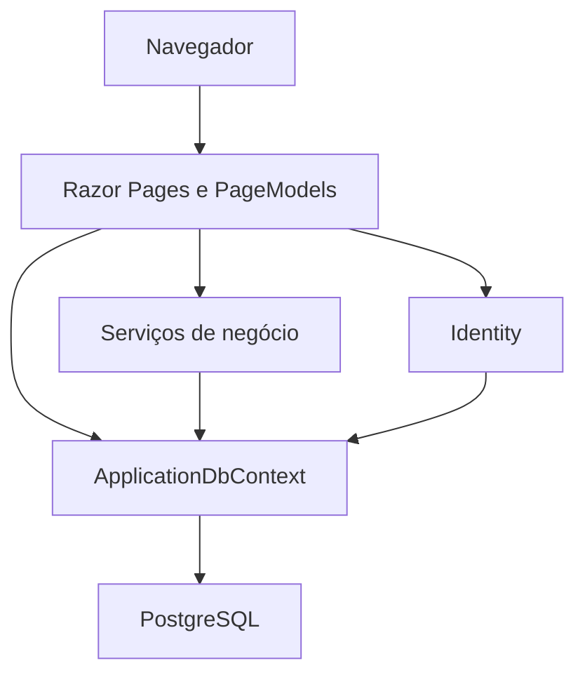

# Churras da Galera — CdG

Aplicação web para organizar encontros, acompanhar confirmações e dividir despesas entre participantes.

O CdG reúne eventos, convites e acertos financeiros em um só lugar. Cada pessoa registra o que pagou, o sistema divide os custos entre os confirmados e acompanha os pagamentos informados e confirmados pelos envolvidos. As transferências de dinheiro acontecem fora da aplicação.

Desenvolvido por **João Paulo Ramalho**, no contexto dos estudos em **Sistemas de Informação na Uniara**, com continuidade além da entrega acadêmica.

## Funcionalidades

- Cadastro, autenticação e atualização do nome de exibição.
- Criação e edição de eventos, limite de participantes e filtros na listagem.
- Convites internos para usuários cadastrados, com aceite e recusa.
- Confirmação de presença, promoção de organizadores e sucessão na saída do último organizador elegível.
- Reagendamento, adiamento sem data, cancelamento e conclusão de eventos.
- Notificações internas, indicador de não lidas e paginação.
- Ocultação e restauração de eventos encerrados no histórico individual.
- Despesas próprias, anulação antes do fechamento e rateio igual entre confirmados.
- Registro manual de pagamentos, confirmação pelo recebedor e renúncia ao crédito restante.

Essas funcionalidades foram identificadas na implementação. A cobertura automatizada é parcial e não substitui os cenários manuais e de concorrência descritos em [Testes](docs/TESTES.md).

## Demonstração visual

As capturas públicas serão acrescentadas com dados fictícios. Os espaços abaixo indicam os cenários que melhor apresentam o sistema, sem imagens simuladas ou links quebrados.

| Captura | Conteúdo a apresentar |
|---|---|
| Visão geral | Próximos eventos, convites e avisos. |
| Organização | Detalhes de um evento com participantes e permissões. |
| Financeiro | Despesas, cotas e saldos de três participantes. |
| Acertos | Um pagamento pendente e sua confirmação. |

<!-- Acrescentar imagens revisadas em docs/imagens/ e inserir os links somente quando os arquivos existirem. -->

## Tecnologias

| Tecnologia | Papel na aplicação |
|---|---|
| C# / .NET 10 | Regras e execução do servidor. |
| ASP.NET Core Razor Pages | Páginas renderizadas no servidor e handlers HTTP. |
| ASP.NET Core Identity | Contas, senhas e autenticação. |
| Entity Framework Core / Npgsql | Persistência e consultas ao PostgreSQL. |
| PostgreSQL | Dados relacionais e bloqueios de linha nas operações transacionais. |
| Bootstrap / jQuery | Layout e recursos de interface e validação. |
| SQLite em memória | Verificações automatizadas de parte das regras financeiras. |

A implementação usa o modelo de páginas do Razor para reunir interface e ações relacionadas, o Identity para reutilizar a infraestrutura de contas e o EF Core para mapear entidades e versionar o esquema. As regras financeiras usam valores inteiros em centavos e transações no banco.

## Arquitetura



É uma aplicação monolítica com separação de responsabilidades por pastas. Algumas regras estão nos serviços e outras nos PageModels. A interface é renderizada no servidor; não há frontend SPA ou API REST independente.

| Caminho | Conteúdo |
|---|---|
| [CdG/Program.cs](CdG/Program.cs) | Inicialização, configuração e registro de serviços. |
| [CdG/Models](CdG/Models) | Entidades e enums. |
| [CdG/Data](CdG/Data) | Contexto e mapeamentos do banco. |
| [CdG/Services](CdG/Services) | Financeiro, participação, notificações e auxiliares. |
| [CdG/Pages](CdG/Pages) | Páginas, formulários e handlers. |
| [CdG/Areas/Identity](CdG/Areas/Identity) | Personalizações de cadastro e conta. |
| [CdG/Migrations](CdG/Migrations) | Evolução do banco. |
| [CdG/ViewComponents](CdG/ViewComponents) | Componente do menu de notificações. |
| [CdG/wwwroot](CdG/wwwroot) | Arquivos estáticos e bibliotecas. |
| [tests/CdG.Verificacao](tests/CdG.Verificacao) | Executável de verificações financeiras. |
| [docs](docs) | Manual técnico, instalação e testes. |

## Executar localmente

Pré-requisitos: **SDK .NET 10**, PostgreSQL em execução e um banco local separado para desenvolvimento. O Visual Studio é opcional; os comandos abaixo partem da raiz do repositório e usam PowerShell.

1. Baixe o código e crie um banco, por exemplo `cdg_demo`, com uma conta que possa aplicar as migrations.
2. Configure a conexão fora dos arquivos versionados, substituindo os marcadores:

```powershell
dotnet user-secrets set "ConnectionStrings:DefaultConnection" "Host=localhost;Port=5432;Database=cdg_demo;Username=SEU_USUARIO;Password=SUA_SENHA" --project CdG/CdG.csproj
```

3. Confira o banco de destino e execute:

```powershell
dotnet restore CdG/CdG.csproj
dotnet build CdG/CdG.csproj
dotnet run --project CdG/CdG.csproj --launch-profile https -- --migrate
dotnet dev-certs https --trust
dotnet run --project CdG/CdG.csproj --launch-profile https
```

Acesse `https://localhost:7103`. O argumento `--migrate` aplica migrations e encerra; o último comando inicia o site. Em Development, o cadastro não exige confirmação de e-mail e, sem SMTP, mensagens não são enviadas.

Consulte [Instalação detalhada](docs/INSTALACAO.md) para configuração, alternativas no Visual Studio, SMTP, Docker e diagnóstico de erros. User Secrets é destinado ao desenvolvimento; em produção, configure segredos no ambiente de hospedagem.

## Executar as verificações

```powershell
dotnet run --project tests/CdG.Verificacao/CdG.Verificacao.csproj
```

É um programa console com 21 verificações, incluindo um laço de 700 combinações de rateio. Usa SQLite em memória e remove `FOR UPDATE` apenas no teste. Não comprova migrations, concorrência PostgreSQL, navegação ou SMTP. `dotnet test` não substitui esse comando.

## Regras e limitações atuais

- O criador começa como organizador com presença confirmada e ocupa uma vaga.
- O rateio usa os confirmados no fechamento, incluindo organizadores confirmados.
- Cancelar o evento não fecha o rateio nem quita dívidas automaticamente.
- Despesas e cotas ficam fixas após fechar; não há reabertura nem estorno de acerto confirmado.
- A renúncia é integral sobre o crédito restante e beneficia devedores em ordem fixa de ID.
- Não há gateway de pagamento, cobrança automática, rateio por consumo ou notificações financeiras automáticas.
- Retorno ao mesmo evento após saída e exclusão automática de contas com histórico não estão disponíveis.
- Reagendamento com despesas seguido de cancelamento sem reconfirmação pode impedir o fechamento; esse cruzamento requer validação e evolução.

Publicação do código não equivale a hospedagem da aplicação. Antes de abrir uma instância para uso externo, precisam ser validados SMTP, HTTPS/proxy, persistência das chaves de autenticação, backup, privacidade e fluxos com PostgreSQL. O Dockerfile está incluído, mas sua presença não comprova implantação funcional.

## Documentação

- [Guia do código](docs/GUIA_DO_CODIGO.md): arquitetura, fluxos, modelo de dados e teoria de C#/POO aplicada aos arquivos reais, incluindo herança, sobrescrita, sobrecarga e interfaces.
- [Instalação](docs/INSTALACAO.md): ambiente e configuração.
- [Testes](docs/TESTES.md): verificações disponíveis, cenários manuais e limites de cobertura.

Possíveis evoluções incluem testes com PostgreSQL, revisão dos fluxos de reconfirmação, operações financeiras mais explícitas e refinamento das políticas de acesso. São propostas, não funcionalidades concluídas.

## Autoria

**João Paulo Ramalho** · Sistemas de Informação — Uniara  
[Perfil no GitHub](https://github.com/johnny-426)

Projeto acadêmico e de portfólio voltado à prática de desenvolvimento web, regras de negócio, banco de dados e documentação técnica. Os avisos de licença dos componentes de terceiros permanecem nos arquivos correspondentes.
