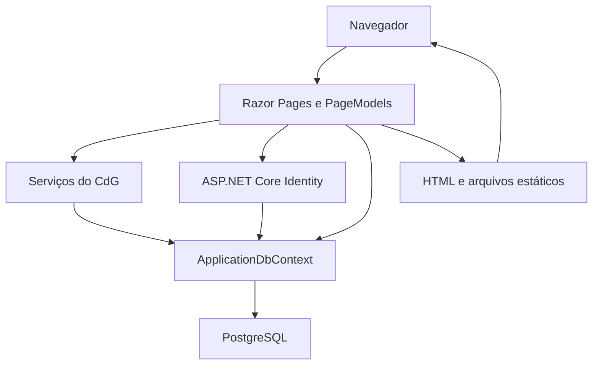
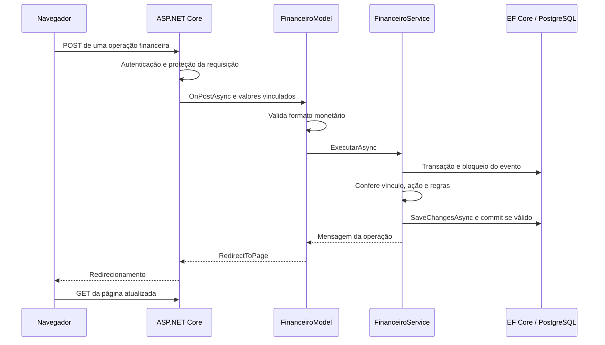
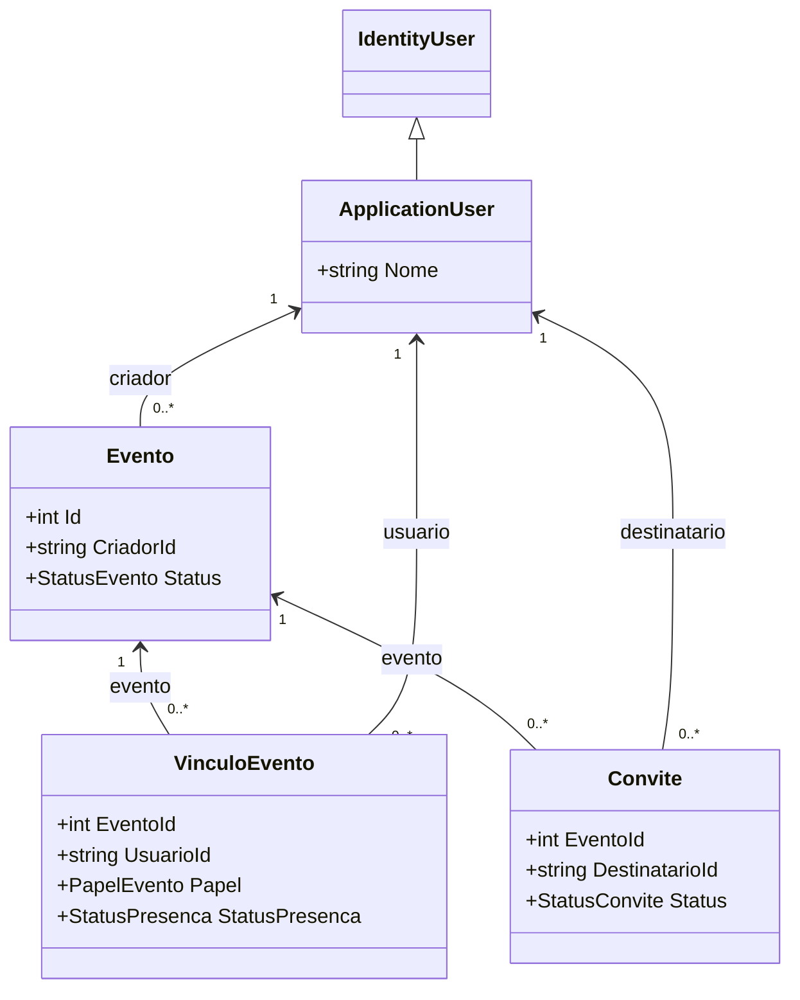
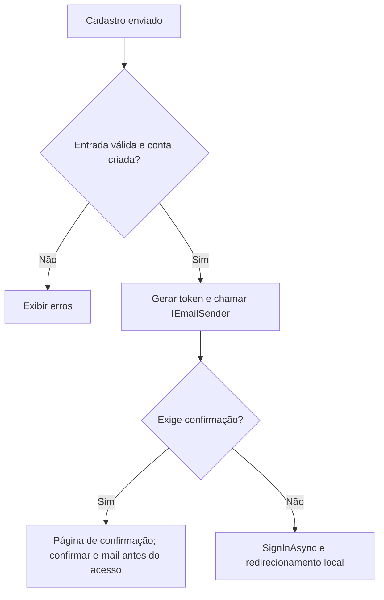
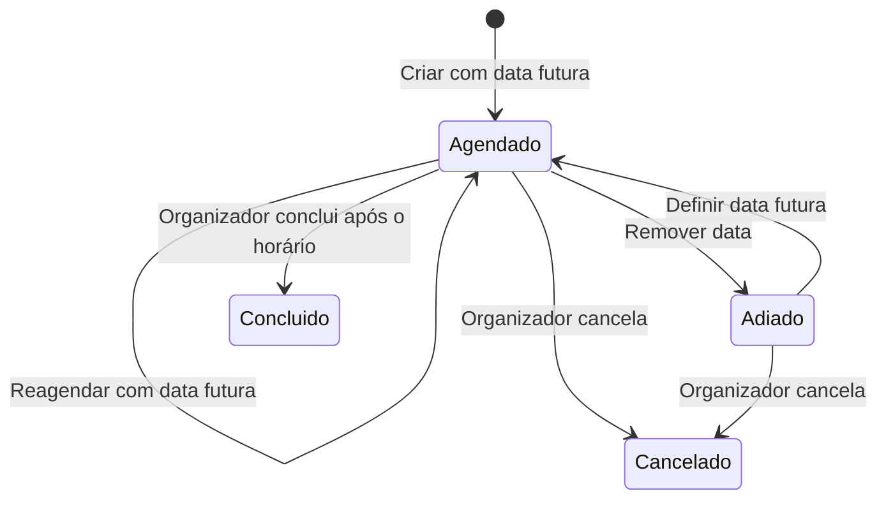
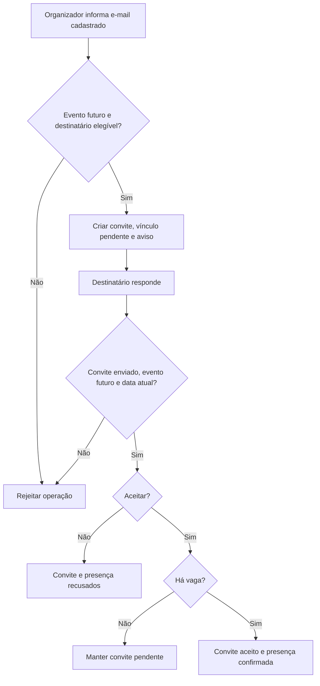
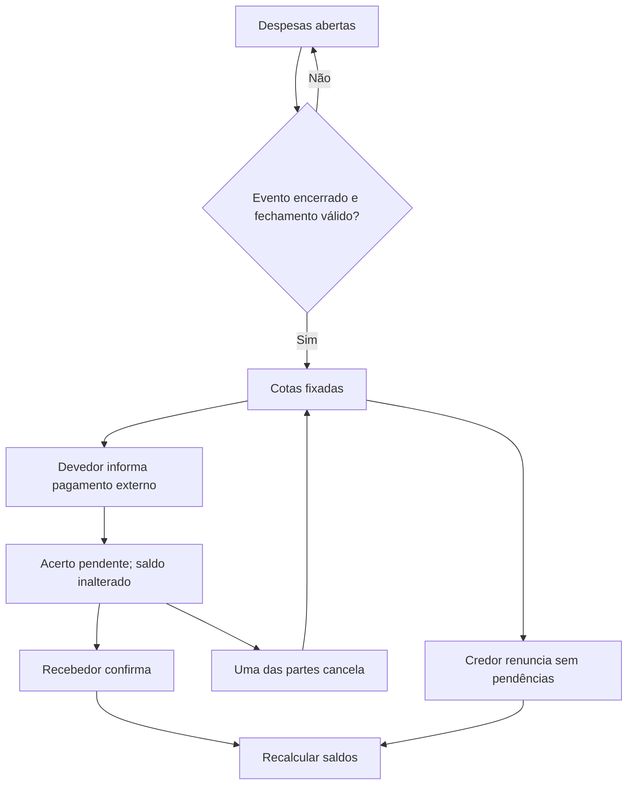
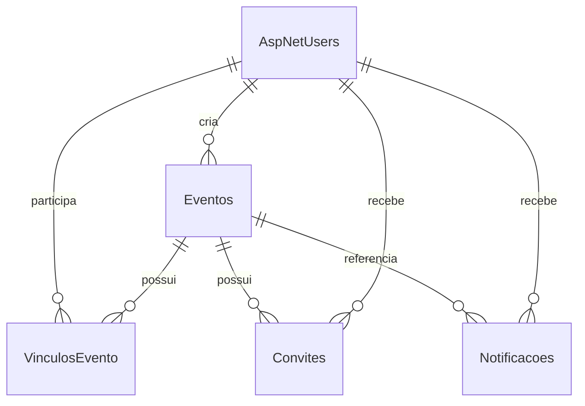
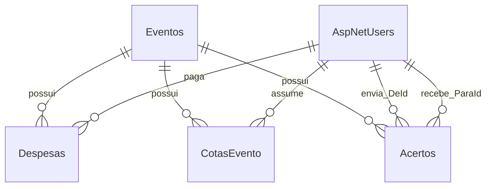

# Guia do código — Churras da Galera

Manual técnico e de leitura de código · C# / ASP.NET Core Razor Pages · revisão de 19/10/2026

O Churras da Galera (CdG) organiza encontros, participação e divisão de despesas. Este manual descreve a implementação existente: uma aplicação web renderizada no servidor, com PostgreSQL e autenticação pelo ASP.NET Core Identity. Os exemplos são trechos do repositório, e não implementações alternativas.

Os caminhos partem da raiz que contém `CdG.slnx`. Nos trechos, partes omitidas são explicadas no texto; o arquivo vinculado continua sendo a referência completa. A análise do código não equivale a executar todos os fluxos. Consulte [Testes](TESTES.md) para distinguir verificações disponíveis de resultados efetivamente executados.

## Índice

1. [Visão geral e roteiro de leitura](#1-visao-geral)
2. [Tecnologias e arquitetura](#2-arquitetura)
3. [Mapa dos arquivos](#3-arquivos)
4. [Inicialização e requisições](#4-inicializacao)
5. [Razor Pages e formulários](#5-razor)
6. [Entidades e estados](#6-entidades)
7. [Programação orientada a objetos no código](#7-poo)
8. [Injeção de dependências e responsabilidades](#8-dependencias)
9. [Identidade, autenticação e autorização](#9-identity)
10. [Eventos](#10-eventos)
11. [Convites, presença e histórico](#11-participacao)
12. [Notificações e interface compartilhada](#12-notificacoes)
13. [Financeiro](#13-financeiro)
14. [Persistência, LINQ e migrations](#14-persistencia)
15. [Transações e concorrência](#15-concorrencia)
16. [Configuração e segurança](#16-configuracao)
17. [Testes e evidências](#17-testes)
18. [Limitações, evolução e glossário](#18-evolucao)

<a id="1-visao-geral"></a>
## 1. Visão geral e roteiro de leitura

O sistema reúne informações que normalmente ficam dispersas em mensagens: onde será o encontro, quem foi convidado, quem confirmou presença, quem pagou despesas e quanto cada pessoa precisa acertar. O pagamento acontece fora da aplicação; o CdG registra a informação e a confirmação do recebedor.

Uma leitura produtiva começa por `Program.cs`, acompanha a criação de um evento, identifica as entidades envolvidas e então segue convites e financeiro. Para compreender os conceitos de orientação a objetos, a seção 7 pode ser lida antes dos fluxos: ela fornece exemplos localizáveis e distingue mecanismos parecidos.

Há três conjuntos de estados independentes: situação do evento, resposta ao convite e presença da pessoa. O financeiro acrescenta fechamento e estados dos acertos. Cancelar um evento não cancela pagamentos; cancelar um registro de pagamento não cancela o evento.

<a id="2-arquitetura"></a>
## 2. Tecnologias e arquitetura

| Tecnologia | Função observada no CdG |
|---|---|
| C# e .NET 10 | Linguagem e plataforma do servidor; o projeto tem `TargetFramework` igual a `net10.0`. |
| ASP.NET Core Razor Pages | Associa páginas e manipuladores HTTP; gera HTML no servidor. |
| ASP.NET Core Identity | Gerencia contas, senhas, autenticação e páginas padrão de conta. |
| Entity Framework Core | Mapeia objetos para tabelas, executa consultas e persiste alterações. |
| Npgsql | Provedor do EF Core para PostgreSQL. |
| PostgreSQL | Armazenamento relacional e bloqueios `FOR UPDATE` usados nas operações concorrentes. |
| Bootstrap, jQuery e validação | Recursos da interface, layout e validação no navegador. |
| SQLite | Banco temporário usado somente pelo executável de verificações. |

Essas funções explicam a adequação técnica das ferramentas; não presumem motivações históricas não registradas pelo autor.



A arquitetura é monolítica: uma aplicação reúne interface, ações e serviços. Há separação por pastas e responsabilidades, mas não projetos independentes de domínio, aplicação e infraestrutura. As páginas também acessam o contexto diretamente. Descrevê-la como Clean Architecture completa ou como uma API REST com frontend separado seria incorreto.

<a id="3-arquivos"></a>
## 3. Mapa dos arquivos

| Caminho | Responsabilidade e dependências |
|---|---|
| [CdG/Program.cs](../CdG/Program.cs) | Configura banco, Identity, serviços e processamento HTTP; é o ponto de composição da aplicação. |
| [CdG/Models](../CdG/Models) | Entidades e enumerações; usadas por páginas, serviços e contexto. |
| [CdG/Data/ApplicationDbContext.cs](../CdG/Data/ApplicationDbContext.cs) | Integra tabelas próprias e Identity; define chaves estrangeiras e índices. |
| [CdG/Services](../CdG/Services) | Regras financeiras, participação, notificações e funções auxiliares. |
| [CdG/Pages](../CdG/Pages) | Interface Razor e handlers; recebem dependências pelo construtor. |
| [CdG/Areas/Identity](../CdG/Areas/Identity) | Personalizações de cadastro e gerenciamento de conta. Outras páginas vêm do pacote Identity UI. |
| [CdG/Migrations](../CdG/Migrations) | Evolução versionada do esquema e preenchimentos de dados existentes. |
| [CdG/ViewComponents](../CdG/ViewComponents) | Consulta de notificações não lidas para o menu. |
| [CdG/wwwroot](../CdG/wwwroot) | CSS, JavaScript, favicon e bibliotecas disponibilizadas ao navegador. |
| [tests/CdG.Verificacao](../tests/CdG.Verificacao) | Programa de verificações financeiras com referência ao projeto web. |
| [CdG.slnx](../CdG.slnx) | Solução contendo o projeto web; o executável de verificações é acionado separadamente. |
| [global.json](../global.json) | Seleção de SDK: base `10.0.100`, com `rollForward` igual a `latestFeature`. |
| [Dockerfile](../Dockerfile) | Compilação em dois estágios e execução na porta interna 8080. Não configura banco nem SMTP. |

As pastas `bin/` e `obj/` são resultados de compilação, não partes da arquitetura a serem versionadas. `ScaffoldingReadMe.txt` registra instruções do gerador de páginas e não substitui este manual.

<a id="4-inicializacao"></a>
## 4. Inicialização e processamento de requisições

Fonte: [Program.cs](../CdG/Program.cs).

`WebApplication.CreateBuilder(args)` prepara configuração, ambiente e registro de serviços. O código exige `ConnectionStrings:DefaultConnection` e registra `ApplicationDbContext` com `UseNpgsql`. A conexão vem da configuração combinada; embora o comentário mencione segredos do usuário, variáveis de ambiente também podem fornecê-la.

```csharp
var connectionString = builder.Configuration
    .GetConnectionString("DefaultConnection")
    ?? throw new InvalidOperationException(
        "A conexão DefaultConnection não foi configurada.");
```

O operador `??` usa o lado direito quando o valor à esquerda é nulo. Aqui, o lado direito lança uma exceção, impedindo que a aplicação prossiga sem conexão configurada. Isso valida a presença da configuração, não testa se o banco está acessível.

Depois são registrados Identity, Razor Pages, e-mail e serviços próprios. `builder.Build()` materializa a aplicação. Se os argumentos contiverem `--migrate`, um escopo resolve o contexto, chama `Database.Migrate()` e termina o processo: o servidor web não começa a atender.

No caminho normal, os componentes HTTP aparecem nesta ordem: cabeçalhos encaminhados, tratamento de erros/HSTS fora de Development, redirecionamento HTTPS, localização `pt-BR`, roteamento, autenticação e autorização. Os endpoints estáticos e Razor Pages são mapeados antes de `Run()`.

Um **middleware** é um componente da cadeia de processamento HTTP. Autenticação preenche a identidade da requisição; autorização usa essa identidade para decidir o acesso. As verificações de vínculo e papel ainda são feitas pelas páginas e serviços.



O diagrama resume o fluxo financeiro; não afirma que toda página utiliza um serviço de negócio. A criação de eventos, por exemplo, persiste diretamente pelo contexto.

<a id="5-razor"></a>
## 5. Razor Pages, formulários e respostas

Fontes: [Criar.cshtml](../CdG/Pages/Eventos/Criar.cshtml), [Criar.cshtml.cs](../CdG/Pages/Eventos/Criar.cshtml.cs) e [Detalhes.cshtml.cs](../CdG/Pages/Eventos/Detalhes.cshtml.cs).

Uma Razor Page reúne uma definição de interface e uma classe de apoio. `.cshtml` mistura HTML com expressões Razor; `.cshtml.cs` contém o `PageModel`, que recebe dados, consulta dependências e escolhe uma resposta. Não é necessário um controller MVC separado para cada página.

| Elemento real | Significado |
|---|---|
| `@page` | Torna a view um endpoint Razor Page. A página financeira acrescenta `"{id:int}"`. |
| `@model` | Declara a classe que fornece os dados da view. |
| `OnGetAsync` / `OnGet` | Handler acionado para GET. |
| `OnPostAsync` | Handler padrão para POST. |
| `OnPostPromoverAsync` | Handler nomeado; o formulário seleciona a ação `Promover`. |
| `[BindProperty]` | Permite preencher uma propriedade a partir dos dados da requisição. |
| `ModelState.IsValid` | Indica se conversão e validações do modelo produziram erros. |
| `[TempData]` | Disponibiliza mensagens entre requisições, especialmente após redirecionamento. |
| `Page()` | Renderiza a página atual, inclusive erros de validação. |
| `RedirectToPage(...)` | Retorna um redirecionamento, e o navegador faz outra requisição. |
| `NotFound()` / `Challenge()` | Responde com recurso não encontrado ou inicia o desafio de autenticação. |

A criação usa a classe interna `DadosEvento` como modelo de entrada. Isso limita os campos vinculados aos que o formulário pode alterar. `CriadorId` e estado inicial são definidos pelo servidor, em vez de aceitar uma entidade inteira enviada pelo cliente.

**Conexão com POO:** `CriarModel : PageModel` usa herança para obter a infraestrutura da página. `DadosEvento` é outra classe, mesmo estando declarada dentro de `CriarModel`. Os handlers são métodos encontrados por convenção; `OnGetAsync` não se torna uma sobrescrita apenas por pertencer a uma classe derivada.

Os atributos `[Required]` e `[StringLength]` são metadados usados pela validação. Não são o mesmo que os campos de um objeto, embora a palavra “atributo” também apareça com esse sentido em aulas de modelagem.

<a id="6-entidades"></a>
## 6. Entidades, relações e estados

Fontes: [Models](../CdG/Models) e [ApplicationDbContext.cs](../CdG/Data/ApplicationDbContext.cs).

| Classe | Dados e papel no domínio |
|---|---|
| `ApplicationUser` | Especializa `IdentityUser` com `Nome`. |
| `Evento` | Identidade, título, descrição, local, data, limite, situação, criador e fechamento financeiro. |
| `VinculoEvento` | Relaciona usuário e evento com papel, presença, aceite, saída e ocultação. |
| `Convite` | Registra destinatário, situação do convite e datas de envio/resposta. |
| `Notificacao` | Mensagem associada a destinatário e evento, com tipo e leitura. |
| `Despesa` | Gasto próprio do pagador, em centavos, com anulação lógica. |
| `CotaEvento` | Parcela individual fixada ao fechar o rateio. |
| `Acerto` | Valor de um devedor para um credor, confirmação, cancelamento ou renúncia. |

`Despesa`, `CotaEvento` e `Acerto` estão no mesmo arquivo `Models/Financeiro.cs`: um arquivo C# pode declarar várias classes. Elas continuam sendo tipos separados.



Este recorte UML mostra herança e associações, sem listar todas as propriedades. As setas de associação acompanham as propriedades de navegação da entidade dependente; não pressupõem coleções de navegação em `Evento` ou `ApplicationUser`.

Os estados persistidos são:

| Enumeração | Valores |
|---|---|
| `StatusEvento` | `Agendado = 1`, `Adiado = 2`, `Concluido = 3`, `Cancelado = 4` |
| `StatusConvite` | `Enviado = 1`, `Aceito = 2`, `Recusado = 3` |
| `StatusPresenca` | `Pendente = 1`, `Confirmada = 2`, `Recusada = 3`, `Cancelada = 4` |
| `PapelEvento` | `Organizador = 1`, `Participante = 2` |
| `TipoNotificacao` | Convite recebido, alteração de data, alteração de local, cancelamento e promoção, com valores de 1 a 5. |

Não existe papel `Criador` no enum: autoria é uma relação de `Evento`, e permissões são consultadas no vínculo. Também não há enum de estado financeiro: `FinanceiroFechadoEm` indica fechamento, e os saldos determinam se há valores a acertar.

<a id="7-poo"></a>
## 7. Programação orientada a objetos aplicada ao código

Esta seção conecta definições a implementações. Nem todo recurso de C# é um princípio de POO, e nem todo princípio precisa gerar uma classe nova.

### 7.1 Classe, objeto, instância e identidade

Uma **classe** define a estrutura e os comportamentos de um tipo. Um **objeto**, ou instância de classe, é uma ocorrência desse tipo durante a execução. `Evento` é a classe; a variável local `evento` em `CriarModel.OnPostAsync` referencia uma instância criada com `new Evento`.

Trecho de [Criar.cshtml.cs](../CdG/Pages/Eventos/Criar.cshtml.cs):

```csharp
var evento = new Evento
{
    Nome = Entrada.Nome.Trim(),
    Descricao = Entrada.Descricao?.Trim(),
    DataHora = horarioUtc,
    Local = Entrada.Local.Trim(),
    LimiteParticipantes = Entrada.LimiteParticipantes,
    CriadorId = usuario.Id,
    Status = StatusEvento.Agendado,
    CriadoEm = agora,
    AtualizadoEm = agora
};
```

`new` cria a instância, e o inicializador atribui propriedades. `var` permite ao compilador inferir o tipo `Evento`; não transforma a variável em um tipo dinâmico. O objeto existe antes de ser salvo. O `Id` persistente e a referência em memória são identidades diferentes: carregar a mesma linha em outro contexto pode gerar outro objeto em memória.

### 7.2 Campos, propriedades e atributos de metadados

Um **campo** guarda estado diretamente. Em `NotificacaoService`, `_context` é um campo privado. Uma **propriedade** expõe acesso por `get` e, quando permitido, `set`. Em `Evento`, `Nome { get; set; }` é uma propriedade automática: o compilador fornece seu armazenamento interno.

`[Required]` é um **atributo de metadados de C#**. Ele descreve uma exigência de validação; não armazena o nome do evento. Esta distinção evita confundir o “atributo Nome” de um diagrama conceitual com a sintaxe de atributos entre colchetes.

`DateTime?` representa um tipo valor que pode ser nulo, como a data de um evento adiado. `string?` sinaliza ao analisador que uma referência pode ser nula. `null!` em propriedades de navegação suprime um aviso do compilador, mas não instancia o objeto nem garante que ele tenha sido carregado pelo EF Core.

### 7.3 Métodos, parâmetros, argumentos e construtores

Um **método** representa uma operação. `NotificacaoService.Criar` recebe parâmetros como `destinatarioId`, `eventoId` e `mensagem`. Na chamada, os valores fornecidos são os argumentos. A assinatura informa os tipos e a ordem esperada.

O **construtor** prepara uma instância. Em [NotificacaoService.cs](../CdG/Services/NotificacaoService.cs):

```csharp
private readonly ApplicationDbContext _context;

public NotificacaoService(ApplicationDbContext context)
{
    _context = context;
}
```

A dependência recebida é guardada para uso posterior. `private` impede acesso direto ao campo por outras classes; `readonly` impede sua reatribuição fora da inicialização/construtor. `readonly` não torna o contexto imutável: ainda é possível chamar operações nele.

`FinanceiroService(ApplicationDbContext db)` usa um **construtor primário**, declarado junto ao nome da classe. Ele também recebe uma dependência; apenas a forma sintática é diferente. Os parâmetros opcionais de `ExecutarAsync`, como `long valor = 0`, permitem omitir argumentos. Isso não cria novas sobrecargas.

### 7.4 Encapsulamento: o que está protegido e o que não está

**Encapsular** é delimitar acesso e preservar responsabilidades/invariantes por uma interface controlada. `DetalhesModel` usa propriedades com `private set`, permitindo leitura externa e restringindo a atribuição à classe. Os serviços escondem dependências em campos privados e expõem operações.

Entretanto, as entidades têm muitas propriedades com `set` público. As regras principais não estão encapsuladas dentro de `Evento` ou `Acerto`; ficam em páginas e serviços. Logo, não basta construir um `Acerto` para garantir um pagamento válido. O fluxo de `FinanceiroService` verifica valores, vínculo e permissões antes de salvar.

Esse desenho é frequente em aplicações baseadas em ORM, mas exige disciplina: um novo fluxo que grave diretamente no contexto pode contornar as regras do serviço. Uma evolução possível seria centralizar mais transições em operações de domínio, sem afirmar que isso já existe.

### 7.5 Herança: relação “é um”

**Herança** permite especializar uma classe existente. Em [ApplicationUser.cs](../CdG/Models/ApplicationUser.cs), `ApplicationUser : IdentityUser` mantém o comportamento e os dados de identidade da classe base e acrescenta `Nome`.

Outros exemplos são `CriarModel : PageModel`, `NotificacoesMenuViewComponent : ViewComponent` e `ApplicationDbContext : IdentityDbContext<ApplicationUser>`. Eles integram componentes próprios aos contratos do framework.

Usar herança é diferente de guardar uma referência: `Evento` possui um `Criador` do tipo `ApplicationUser`, mas não herda de usuário. Trata-se de associação, não de especialização.

### 7.6 Sobrescrita: especializar comportamento herdado

**Sobrescrita**, ou *override*, ocorre quando a classe derivada fornece uma implementação para um método virtual ou abstrato herdado. O nome e a assinatura precisam corresponder ao contrato da base; em C#, usa-se `override`.

Em [ApplicationDbContext.cs](../CdG/Data/ApplicationDbContext.cs), a declaração real é:

```csharp
protected override void OnModelCreating(ModelBuilder builder)
```

O corpo começa com `base.OnModelCreating(builder)`, preservando a configuração de Identity, e acrescenta relacionamentos e índices do CdG. `base` acessa a implementação da classe base; não cria outro contexto. A finalidade da sobrescrita é ampliar a configuração do modelo quando o EF Core a solicitar.

As migrations também usam `protected override void Up(MigrationBuilder migrationBuilder)` e `Down(...)` para definir mudanças e reversões. No teste, `SemForUpdate : DbCommandInterceptor` sobrescreve `ReaderExecutingAsync` para adaptar o comando ao SQLite. Esses exemplos têm efeitos diferentes, mas usam o mesmo mecanismo de linguagem.

`protected` permite acesso pela própria classe e por derivadas. `override` é um modificador de método; não é um atributo entre colchetes.

**O que não é sobrescrita:** os handlers `OnPostAsync` das páginas não usam esse mecanismo; o Razor Pages os descobre por convenção. `EmailSender.SendEmailAsync` implementa uma interface, sem sobrescrever um método de classe base.

### 7.7 Sobrecarga: mesmo nome, parâmetros diferentes

**Sobrecarga**, ou *overload*, disponibiliza métodos de mesmo nome com listas de parâmetros diferentes. A escolha normalmente ocorre na compilação, a partir dos tipos e argumentos. Mudar apenas o tipo de retorno não basta para criar uma sobrecarga.

O CdG **utiliza sobrecargas fornecidas por `PageModel`**. Em [Detalhes.cshtml.cs](../CdG/Pages/Eventos/Detalhes.cshtml.cs), aparecem estas chamadas reais:

```csharp
return RedirectToPage(new { id });
```

```csharp
return RedirectToPage("/Eventos/Index");
```

Na primeira, um objeto anônimo fornece valores de rota para a página atual. Na segunda, uma string identifica outra página. O projeto consome duas assinaturas da API herdada; não declara um par próprio de métodos `RedirectToPage`.

Não foi identificada uma família própria de sobrecargas nos serviços de domínio. Métodos `FormatarData` ou `OnGetAsync` repetidos em classes diferentes não demonstram, por si, sobrecarga. Tampouco `OnPostCancelarAsync` e `OnPostConcluirAsync`: os nomes são diferentes.

| Mecanismo | O que varia | Exemplo do CdG |
|---|---|---|
| Sobrescrita | Implementação de um contrato herdado | `OnModelCreating` no contexto |
| Sobrecarga | Lista de parâmetros sob o mesmo nome | Chamadas a `RedirectToPage` com string ou valores de rota |
| Implementação de interface | Classe cumpre operações de um contrato | `EmailSender : IEmailSender` |
| Parâmetro opcional | Argumento pode ser omitido em uma assinatura | Valores padrão em `ExecutarAsync` |

### 7.8 Abstração e interfaces

**Abstração** expõe o que uma operação oferece e omite detalhes necessários apenas à implementação. `IEmailSender` define a capacidade de enviar e-mail. `RegisterModel` pede esse contrato pelo construtor, sem precisar criar `SmtpClient`.

Em [EmailSender.cs](../CdG/Services/EmailSender.cs), a classe implementa `IEmailSender` e executa o envio por SMTP. O registro em [Program.cs](../CdG/Program.cs) conecta contrato e implementação:

```csharp
builder.Services.AddTransient<IEmailSender, EmailSender>();
```

Isso permite que o consumidor dependa da capacidade de enviar mensagens. Não há uma segunda implementação própria atualmente; a possibilidade de substituição é estrutural, não uma funcionalidade já adicionada.

Uma **classe abstrata** pode compartilhar estado e implementação com suas derivadas e não pode ser instanciada diretamente. Uma interface define um contrato de capacidades. O domínio próprio do CdG não declara uma classe `abstract` nem uma interface própria de negócio; utiliza contratos e classes base do framework. Abstração como princípio de projeto é mais ampla que usar a palavra-chave `abstract`.

`IQueryable<VinculoEvento>` e `IEnumerable<string>` também são interfaces usadas no projeto. A primeira permite compor consultas traduzíveis pelo provedor; a segunda expõe uma sequência de IDs ao cálculo de rateio. Nenhuma exige que o método consumidor receba uma implementação concreta específica de coleção.

### 7.9 Polimorfismo

**Polimorfismo** permite operar por um contrato comum enquanto a implementação concreta determina o comportamento. Quando `RegisterModel` chama `_emailSender.SendEmailAsync`, sua referência tem tipo `IEmailSender`, e o objeto fornecido pelo contêiner é `EmailSender`.

A sobrescrita de `OnModelCreating` também participa de despacho virtual: a infraestrutura chama o comportamento especializado do contexto. Esse é polimorfismo de execução. A sobrecarga às vezes é ensinada como polimorfismo estático; é útil separar os dois, pois a escolha por parâmetros não é o mesmo que a escolha por implementação concreta em execução.

### 7.10 Associação, agregação e composição

**Associação** é uma relação entre objetos: `Convite.Evento` e `Convite.Destinatario` são exemplos claros. `VinculoEvento` materializa uma relação muitos-para-muitos com informações próprias, como papel e presença.

**Agregação** descreve uma relação todo-parte em que as partes podem existir independentemente. **Composição**, no sentido estrito da UML, exige posse e dependência de ciclo de vida mais fortes. Essas semânticas não decorrem automaticamente de uma chave estrangeira ou da palavra “tem”.

No CdG, os relacionamentos de domínio são documentados como associações. Usuários existem sem um evento, e exclusões são restringidas por `DeleteBehavior.Restrict`. Não há base suficiente para desenhar losangos de composição em todas as relações financeiras. O uso de objetos colaboradores por um serviço é composição de comportamento em sentido amplo, mas não prova composição UML com ciclo de vida exclusivo.

### 7.11 Classes estáticas, métodos de extensão e recursos de C#

`CalculoRateio` é uma classe estática: agrupa uma operação sem estado de instância. Não se usa `new CalculoRateio()`. A saída depende do total e dos IDs recebidos; o método não consulta o banco.

Em [ConsultasParticipacao.cs](../CdG/Services/ConsultasParticipacao.cs):

```csharp
public static IQueryable<VinculoEvento> Ativos(this IQueryable<VinculoEvento> consulta)
    => consulta.Where(v => v.SaiuEm == null && v.OcultadoDoHistoricoEm == null);
```

O parâmetro `this` transforma o método estático em **método de extensão**, permitindo `_context.VinculosEvento.Ativos()`. Isso não altera a definição de `IQueryable` nem cria herança. A função retorna uma consulta com filtro comum, ainda não materializada.

`async`/`await` permitem aguardar operações de entrada/saída sem bloquear a thread durante a espera. Não significam que todas as consultas estão sendo executadas em paralelo. `Task<T>` representa a conclusão futura de uma operação e seu resultado. Esses são recursos de programação assíncrona, usados junto da POO.

`List<T>`, `Dictionary<TKey,TValue>` e `HashSet<T>` são tipos genéricos: preservam informação de tipo dos elementos. No CdG, listas representam registros carregados; dicionários associam IDs a saldos; conjuntos guardam IDs elegíveis para promoção sem repetição.

<a id="8-dependencias"></a>
## 8. Injeção de dependências e separação de responsabilidades

Injeção de dependências fornece colaboradores à classe, em vez de fazê-la construí-los internamente. O contêiner do ASP.NET Core resolve os parâmetros dos construtores com base nos registros de `Program.cs`.

| Serviço | Registro | Implicação |
|---|---|---|
| `ApplicationDbContext` | `AddDbContext` | Escopo padrão; páginas e serviços do mesmo escopo compartilham o contexto resolvido. |
| `NotificacaoService` | `AddScoped` | Uma instância por escopo. |
| `ParticipacaoService` | `AddScoped` | Usa contexto e serviço de notificações do escopo. |
| `FinanceiroService` | `AddScoped` | Usa o contexto do escopo. |
| `IEmailSender` → `EmailSender` | `AddTransient` | Nova instância por resolução. |

Em requisições HTTP, o escopo normalmente corresponde à requisição. O caminho `--migrate` cria um escopo explicitamente, pois não está atendendo uma requisição.

**Injeção de dependências não garante, sozinha, inversão de dependência completa.** `FinanceiroService` é injetado como classe concreta e depende diretamente do EF Core. Já o cadastro depende da abstração `IEmailSender`.

| Princípio SOLID | Leitura honesta da implementação |
|---|---|
| Responsabilidade única | `CalculoRateio` tem responsabilidade delimitada. `DetalhesModel` concentra muitas ações; `ExecutarAsync` concentra várias operações financeiras. |
| Aberto/fechado | Interfaces do framework permitem substituições. Novas ações financeiras exigem editar a cadeia de condições existente. |
| Substituição de Liskov | Há uso de tipos derivados nas APIs do framework, mas isso não basta para declarar conformidade de todo o sistema ao princípio. |
| Segregação de interfaces | `IEmailSender` é um contrato específico. O domínio não possui um conjunto próprio de interfaces segregadas. |
| Inversão de dependência | Presente no consumo de contratos do framework; parcial na lógica própria, ainda acoplada ao contexto e a serviços concretos. |

Extrair ações financeiras para métodos explícitos, adotar resultados tipados e reduzir duplicação dos handlers são oportunidades futuras. Este manual não pressupõe que essas refatorações já tenham sido feitas.

<a id="9-identity"></a>
## 9. Identidade, autenticação e autorização

Fontes: [Register.cshtml.cs](../CdG/Areas/Identity/Pages/Account/Register.cshtml.cs), [gerenciamento da conta](../CdG/Areas/Identity/Pages/Account/Manage/Index.cshtml.cs), [exclusão](../CdG/Areas/Identity/Pages/Account/Manage/DeletePersonalData.cshtml.cs) e [PermissoesEvento.cs](../CdG/Services/PermissoesEvento.cs).

O cadastro valida entrada, instancia `ApplicationUser`, preenche nome/e-mail e chama `UserManager.CreateAsync` com a senha. O Identity cuida do armazenamento da senha; não há uma propriedade própria de senha em `ApplicationUser`.



O desenho representa o caminho sem falha no envio. Fora de Development, a configuração exige confirmação. Se SMTP não estiver configurado, o envio lança exceção; a criação da conta já pode ter ocorrido. Em Development, sem host SMTP, `EmailSender` retorna sem enviar e o cadastro pode autenticar diretamente.

A ausência de `Login.cshtml` local não significa ausência de login: as páginas padrão são fornecidas por Identity UI. O cadastro consulta esquemas externos, mas não há provedor social configurado em `Program.cs`; não se deve anunciar login Google ou outro provedor.

**Autenticação** responde quem é o usuário. **Autorização** determina o que ele pode fazer. `[Authorize]` exige autenticação; `PermissoesEvento.EhOrganizadorAsync` verifica evento, usuário, papel Organizador, ausência de saída e ausência de ocultação. As permissões são por evento, não cargos administrativos globais.

Alterar o nome chama `UserManager.UpdateAsync` e atualiza o cookie com `RefreshSignInAsync`. A exclusão automática é bloqueada quando há histórico relacionado; contas sem histórico seguem a validação de senha e exclusão. Uma violação de chave estrangeira também é tratada para a possibilidade de uma relação ter sido criada entre consulta e exclusão.

<a id="10-eventos"></a>
## 10. Criação e gerenciamento de eventos

Fontes: [Criar](../CdG/Pages/Eventos/Criar.cshtml.cs), [Editar](../CdG/Pages/Eventos/Editar.cshtml.cs), [Adiar](../CdG/Pages/Eventos/Adiar.cshtml.cs), [Detalhes](../CdG/Pages/Eventos/Detalhes.cshtml.cs).

### Criação

O POST valida os campos, identifica o usuário e converte a data informada no fuso `E. South America Standard Time` para UTC. A data precisa ser futura. O código cria `Evento` e `VinculoEvento`, com o criador como organizador confirmado. Adicionar o vínculo com a referência para o novo evento permite ao EF persistir o grafo relacionado em `SaveChangesAsync`.

Consequência: o organizador inicial ocupa vaga e participa do rateio se continuar confirmado no fechamento. Não existe participação administrativa automaticamente isenta de custos.

### Edição e reagendamento

`EditarModel` altera nome, descrição, local e limite. Não permite reduzir a capacidade abaixo do número atual de confirmados. Mudança de local produz notificação para os outros vínculos ativos. A data é tratada pela página `Adiar`.

`AdiarModel` aceita uma data futura ou campo vazio. Com data, o evento fica Agendado; sem data, fica Adiado. Quando a data muda, presenças confirmadas ficam Pendentes, inclusive a do organizador. O estado dos convites não é reiniciado. Ambas as páginas comparam `VersaoOriginal` com `VersaoEvento.Obter` antes de salvar.



### Encerramento e promoção

Cancelamento é permitido a organizadores em eventos agendados ou adiados e envia avisos. Não há campo de motivo no handler de cancelamento. Conclusão exige evento agendado, com horário já alcançado. Não é automática quando a data passa.

A promoção exige organizador ativo, evento ainda não encerrado e participante com aceite registrado ou convite aceito. A nova pessoa recebe notificação e ganha as permissões de organização. O criador não detém exclusividade de cancelamento.

**Limite a validar:** reagendar remove confirmações, mas mantém despesas já registradas. Se um evento for cancelado sem recuperar essas confirmações, o fechamento pode ficar bloqueado por falta de confirmados ou por despesas de pessoas não confirmadas. O teste desse cruzamento está documentado em [TESTES.md](TESTES.md); não há correção aplicada nesta entrega.

<a id="11-participacao"></a>
## 11. Convites, presença, saída e histórico

Fontes: [Convidar](../CdG/Pages/Eventos/Convidar.cshtml.cs), [resposta aos convites](../CdG/Pages/Convites/Index.cshtml.cs), [ParticipacaoService](../CdG/Services/ParticipacaoService.cs) e [Meus eventos](../CdG/Pages/Eventos/Index.cshtml.cs).

O convite é destinado a uma conta já cadastrada, encontrada pelo e-mail. A operação cria `Convite`, `VinculoEvento` pendente e `Notificacao` na mesma unidade transacional. Não envia um e-mail de convite: a notificação é interna.



O remetente não pode convidar a si próprio. Convite ou vínculo anterior impede novo convite; saída anterior também bloqueia retorno. Ao responder, o servidor verifica propriedade do convite, estado, data exibida (`dataTicks`) e lotação. Isso impede confirmar silenciosamente uma data diferente da vista no formulário.

Na tela de detalhes, a presença pode mudar em evento agendado futuro, depois de responder ao convite inicial. A mudança não reescreve a resposta histórica do convite. Assim, uma pessoa que recusou inicialmente pode posteriormente confirmar presença pelos detalhes enquanto as condições permitirem; isso é diferente de sair do evento, que impede retorno.

### Saída e sucessão

`SairAsync` exige vínculo ativo e evento agendado/adiado. Despesas próprias não anuladas bloqueiam a saída. Se for o último organizador, busca participante elegível pelo aceite mais antigo, com desempate pelo ID do vínculo e exclusão de convites ainda pendentes. Sem sucessor, bloqueia a operação; não exclui o evento.

Na saída bem-sucedida, registra `SaiuEm`, muda o papel para Participante e a presença para Cancelada, atualiza o evento, recusa convite pendente e marca avisos não lidos como lidos. O registro permanece no banco.

### Ocultação e consultas diferentes

Ocultar ou restaurar é permitido para eventos cancelados ou concluídos. `OcultadoDoHistoricoEm` pertence ao vínculo da pessoa, portanto a alteração não esconde o evento para todos. Restaurar não apaga `SaiuEm` nem reativa uma participação encerrada.

A listagem `Meus eventos` não filtra sempre `SaiuEm`: pode mostrar uma participação encerrada como histórico. Já detalhes usa vínculos não saídos e não ocultos. O financeiro verifica ausência de saída, mas não exige ausência de ocultação para acesso direto. Ocultar não apaga dívidas nem é uma revogação uniforme de acesso. Um organizador que ocultou o evento deixa de passar pela verificação de organizador enquanto não o restaurar.

<a id="12-notificacoes"></a>
## 12. Notificações e interface compartilhada

Fontes: [NotificacaoService](../CdG/Services/NotificacaoService.cs), [listagem](../CdG/Pages/Notificacoes/Index.cshtml.cs), [ViewComponent](../CdG/ViewComponents/NotificacoesMenuViewComponent.cs) e [view do componente](../CdG/Pages/Shared/Components/NotificacoesMenu/Default.cshtml).

`Criar` instancia a notificação e a adiciona ao contexto, mas não chama `SaveChangesAsync`. O fluxo que chamou o serviço persiste junto suas alterações. Essa escolha permite que convite, vínculo e aviso sejam confirmados na mesma transação.

`AvisarParticipantesAsync` seleciona vínculos ativos, exclui o autor e remove duplicidades de destinatário. O filtro não exige presença confirmada: “ativo” significa não ter saído nem ocultado o evento.

A listagem oferece filtro de não lidas, paginação de dez itens, marcação individual e marcação de todas. A propriedade `EventosAcessiveis` orienta os links para eventos que ainda podem ser abertos.

No layout, `Component.InvokeAsync("NotificacoesMenu")` aciona o componente, que conta notificações não lidas e retorna sua view. O modelo dessa view é um `int`, não uma entidade completa. Acima de 99, o indicador mostra `99+`.

Não há SignalR ou mecanismo próprio de atualização em tempo real. O indicador é calculado na renderização; operações financeiras não criam novos tipos de notificação nesta versão. `_Layout.cshtml` organiza a navegação, `_LoginPartial.cshtml` exibe opções de sessão e `wwwroot` fornece recursos estáticos. `site.js` é essencialmente o arquivo de template, não um frontend de aplicação independente.

<a id="13-financeiro"></a>
## 13. Financeiro: despesas, rateio e acertos

Fontes: [entidades financeiras](../CdG/Models/Financeiro.cs), [CalculoRateio](../CdG/Services/CalculoRateio.cs), [FinanceiroService](../CdG/Services/FinanceiroService.cs) e [FinanceiroModel](../CdG/Pages/Eventos/Financeiro.cshtml.cs).

### 13.1 Valores e validação

As entidades usam `long Centavos`. R$ 12,50 corresponde ao inteiro 1250. O formulário aceita vírgula ou ponto decimal, até duas casas e sem separador de milhar. A conversão passa por `decimal`, multiplica por 100 e só então produz `long`. A exibição divide por `100m`, usando `decimal` e cultura `pt-BR`.

O valor informado na página deve ser positivo e no máximo R$ 1.000.000,00. O serviço também confere o limite para despesas, além de descrição não vazia e com até 200 caracteres. A validação financeira não deve depender apenas dos atributos HTML.

### 13.2 Registro e fechamento

Participantes confirmados registram despesas próprias. Só o autor pode anulá-las antes do fechamento. A anulação mantém a linha e retira seu valor das somas. Não há edição direta da despesa: a correção ocorre por anulação e novo registro.

Organizadores fecham o rateio apenas em eventos concluídos ou cancelados. É preciso haver pelo menos um confirmado não saído, e todo pagador de despesa ativa precisa pertencer a esse conjunto. O serviço cria as cotas e preenche `FinanceiroFechadoEm`. Esse fechamento é definitivo na versão documentada.

O serviço permite despesas enquanto o financeiro estiver aberto e a presença do autor estiver confirmada, inclusive após o encerramento do evento. Encerramento do evento e fechamento financeiro são ações distintas.

### 13.3 Divisão e centavos restantes

Trecho integral do método de [CalculoRateio.cs](../CdG/Services/CalculoRateio.cs):

```csharp
public static Dictionary<string, long> Dividir(long total, IEnumerable<string> usuarios)
{
    var ids = usuarios.Distinct().OrderBy(x => x, StringComparer.Ordinal).ToArray();
    if (total < 0 || ids.Length == 0) throw new ArgumentException("Rateio inválido.");
    return ids.Select((id, i) => new { id, valor = total / ids.Length + (i < total % ids.Length ? 1 : 0) })
        .ToDictionary(x => x.id, x => x.valor);
}
```

O método elimina IDs repetidos e usa ordenação ordinal para um resultado estável. A divisão inteira define a cota base; o resto determina quantas pessoas recebem um centavo adicional. Para 1000 centavos e três IDs, as cotas são 334, 333 e 333. A diferença máxima é um centavo e a soma é preservada.

**Conexão com teoria:** é um método estático que recebe uma abstração de sequência (`IEnumerable<string>`) e retorna um dicionário genérico. O `Select` usa uma expressão lambda com índice; o objeto anônimo intermediário contém `id` e `valor`. Essas transformações operam em memória após `ToArray`, não em SQL.

### 13.4 Cálculo dos saldos

`SaldosAsync` começa com o negativo de cada cota, soma as despesas não anuladas de cada pagador e aplica acertos não cancelados com `ConfirmadoEm` preenchido. Para quem paga um acerto, soma o valor ao saldo; para quem recebe, subtrai.

**Saldo = despesas pagas − cota + acertos confirmados enviados − acertos confirmados recebidos.**

No cenário usado pelo teste existente, A gastou R$ 100, B gastou R$ 20 e C não gastou. As cotas são R$ 40: A recebe R$ 60, B paga R$ 20 e C paga R$ 40. Informar um pagamento ainda pendente não altera esses saldos.

### 13.5 Operações e permissões

| Ação em `ExecutarAsync` | Regra principal |
|---|---|
| `despesa` | Financeiro aberto, participante confirmado, valor e descrição válidos. |
| `anular` | Financeiro aberto e autor da despesa. |
| `fechar` | Organizador, evento encerrado, confirmados e pagadores elegíveis. |
| `pagar` | Financeiro fechado, devedor para credor, valor dentro da dívida e do crédito. |
| `confirmar` | Somente o recebedor, acerto pendente, com saldos suficientes. |
| `cancelar` | Pagador ou recebedor, somente enquanto pendente. |
| `renunciar` | Credor com saldo positivo e sem qualquer acerto pendente no evento. |

Ao informar pagamento, o serviço bloqueia outro registro pendente que tenha o mesmo devedor ou o mesmo credor de destino. Esse bloqueio é deliberadamente amplo: pagamentos parciais também precisam aguardar a resolução da pendência correspondente.



### 13.6 Renúncia e registros históricos

Renunciar não transfere dinheiro. O serviço percorre devedores em ordem ordinal de ID, usa o menor valor entre o crédito restante e cada dívida e cria acertos com `Renuncia = true` e confirmação imediata. O efeito é reduzir créditos e dívidas preservando o equilíbrio.

A renúncia é integral sobre o crédito restante do autor; não é uma escolha de percentual ou beneficiário. O histórico permite distinguir pagamento recebido de renúncia. Não existe estorno de acerto confirmado nem desfazer renúncia pela interface.

### 13.7 Cancelamento do evento não é reembolso

O cancelamento muda o estado do evento. O financeiro pode continuar aberto ou manter acertos pendentes. Em um cancelamento, os registros devem representar custos efetivamente suportados: despesas devolvidas precisam ser anuladas antes de fechar. Não há fluxo próprio de reembolso bancário nem estado “aguardando reembolso”.

<a id="14-persistencia"></a>
## 14. EF Core, consultas e migrations

### 14.1 O contexto e os relacionamentos

Fonte: [ApplicationDbContext.cs](../CdG/Data/ApplicationDbContext.cs).

`DbContext` é a unidade de trabalho do EF: compõe consultas, acompanha entidades e envia alterações ao banco. `DbSet<Evento>` representa o conjunto consultável, não uma lista que já contenha todos os eventos.

O mapeamento `HasOne(...).WithMany().HasForeignKey(...)` define relações, mesmo sem coleção de navegação no lado principal. `DeleteBehavior.Restrict` impede a exclusão do principal quando dependentes a tornam inválida. Há índices únicos para vínculo por evento/usuário, convite por evento/destinatário e cota por evento/usuário.





Os dois diagramas representam as tabelas próprias ligadas a `AspNetUsers`. As demais tabelas internas de Identity não foram expandidas. Cada dependente exige um principal por chave estrangeira; um principal pode ter zero ou muitos dependentes. Em `Acertos`, as duas relações com usuários são distintas.

### 14.2 LINQ, execução e rastreamento

LINQ permite expressar filtros e projeções em C#. Sobre `IQueryable`, operadores como `Where`, `Select` e `OrderBy` compõem uma expressão que o EF tenta traduzir em SQL. `ToListAsync`, `CountAsync` e `SingleOrDefaultAsync` executam consultas.

`Include` carrega dados relacionados, como o usuário de uma despesa. `AsNoTracking` evita o acompanhamento de alterações em consultas de leitura. Alterar um objeto carregado com rastreamento e chamar `SaveChangesAsync` permite persistir a mudança; fazer isso com um objeto sem rastreamento exige tratamento adicional.

O filtro de extensão `Ativos()` permanece traduzível porque devolve `IQueryable`. Já o cálculo de rateio recebe IDs materializados e usa LINQ em memória. Embora a sintaxe seja semelhante, os locais de execução são diferentes.

### 14.3 Evolução do banco

As migrations versionadas incluem:

| Identificador | Objetivo |
|---|---|
| `20261008123929_CriacaoInicialIdentity` | Estruturas iniciais do Identity. |
| `20261008171254_AdicionarEventos` | Tabela de eventos. |
| `20261009185651_AdicionarVinculosEvento` | Relações entre eventos e usuários. |
| `20261009190825_PreencherOrganizadoresExistentes` | Preenche vínculos de criadores de eventos existentes. |
| `20261010120352_AdicionarConvites` | Estrutura de convites. |
| `20261013032918_AdicionarNotificacoes` | Notificações internas. |
| `20261013051221_AdicionarNomeUsuario` | Nome de exibição do usuário. |
| `20261013182812_PrepararSaidaEHistoricoParticipantes` | Aceite, saída e ocultação. |
| `20261014141002_PreencherAceitesAntigos` | Recupera datas de aceite a partir dos registros existentes. |
| `20261018123556_AdicionarFinanceiro` | Despesas, cotas, acertos e fechamento. |

`Up` descreve a aplicação da mudança; `Down`, sua reversão quando disponível. `PreencherAceitesAntigos.Down` lança `NotSupportedException`: esse preenchimento não pode ser revertido automaticamente com segurança. `PreencherOrganizadoresExistentes.Down` preserva os vínculos preenchidos. Portanto, não se deve prometer rollback integral de todas as migrations.

O arquivo `ApplicationDbContextModelSnapshot.cs` registra o modelo para futuras comparações do EF. Os arquivos `.Designer.cs` complementam as migrations geradas. Não são documentos históricos dispensáveis; devem acompanhar o código público.

O comando de inicialização `--migrate` aplica migrations existentes. Não é necessário criar uma migration nova para instalar. O uso de `EnsureCreatedAsync` aparece no teste SQLite e não substitui o caminho de migrations no PostgreSQL.

<a id="15-concorrencia"></a>
## 15. Transações, bloqueios e versões de formulário

Transação agrupa operações que devem ser confirmadas juntas. `BeginTransactionAsync` inicia; `CommitAsync` confirma. Se o fluxo sai sem commit, o descarte da transação não confirma as alterações. Isso evita deixar apenas parte de um convite ou fechamento persistida.

Os fluxos relevantes usam uma consulta ao evento com `FOR UPDATE`. O PostgreSQL bloqueia a linha durante a transação, coordenando operações que seguem o mesmo protocolo. No aceite, por exemplo, a lotação é consultada depois de adquirir o bloqueio. Duas respostas concorrentes à última vaga devem ser serializadas.

`FromSqlInterpolated` recebe a interpolação como dados parametrizados do EF, em vez de concatenar diretamente a entrada em SQL. Substituir essa chamada por montagem textual de SQL pode alterar suas propriedades de segurança.

Há também proteção contra edição de formulário antigo: [VersaoEvento.cs](../CdG/Services/VersaoEvento.cs) serializa campos relevantes e calcula SHA-256. Edição e adiamento comparam esse valor com o enviado pelo formulário. Não é assinatura criptográfica de autorização, senha nem `rowversion` gerenciado pelo banco: é um detector de mudança de conteúdo.

A presença e a resposta ao convite comparam os ticks da data apresentada. São proteções complementares: bloquear uma linha coordena concorrência durante a operação; comparar versões detecta dados antigos exibidos antes dela.

O bloqueio não torna o sistema inteiro automaticamente livre de condições de corrida. Leitura dos saldos faz múltiplas consultas, e operações novas precisam respeitar o protocolo. O teste SQLite remove a cláusula `FOR UPDATE`, logo não comprova essas garantias.

<a id="16-configuracao"></a>
## 16. Configuração e segurança

A instalação completa está em [INSTALACAO.md](INSTALACAO.md). Os arquivos `appsettings.json` e `appsettings.Development.json` fornecidos não contêm conexão de banco. O `UserSecretsId` identifica o armazenamento de desenvolvimento; não é uma senha, mas cópias do projeto no mesmo computador podem compartilhar esses valores.

| Mecanismo | Uso real e limite |
|---|---|
| Identity e `[Authorize]` | Identificam o usuário e restringem páginas; não substituem as verificações por evento. |
| Validações no servidor | Conferem entrada, estados e permissões; esconder botão não é controle de acesso suficiente. |
| Antiforgery de Razor Pages | Protege POSTs pelos mecanismos do framework e Tag Helpers usados nos formulários. |
| Data Protection | `SetApplicationName("CdG")`; persistência opcional no caminho configurado. A proteção das chaves em repouso depende do ambiente. |
| Proxy conhecido | Lê um IP de `ReverseProxy:KnownProxy`; a infraestrutura real precisa ser compatível. |
| HTTPS e HSTS | Configurados no pipeline; dependem de terminação TLS e encaminhamento corretos na hospedagem. |
| `AllowedHosts` | Vem como `*` no arquivo base; deve refletir o ambiente de implantação. |
| SMTP | STARTTLS com `SmtpClient`; sem host em Development, não envia. Fora dele, lança erro. |

O financeiro é consultável por usuário vinculado que não saiu, sem exigir convite aceito. Isso inclui vínculo criado por convite pendente. Esse comportamento e a exibição de e-mails aos organizadores precisam ser compreendidos ao usar dados reais. A página de privacidade descreve o compartilhamento básico, mas ainda exige definição operacional de contato, retenção e exclusão antes de uso externo.

`wwwroot` é destinado a arquivos públicos do site. Segredos, backups e materiais pessoais não devem ser colocados ali. Publicar código no GitHub e hospedar a aplicação são operações diferentes: uma não configura a outra.

<a id="17-testes"></a>
## 17. Testes disponíveis e evidências

Fonte: [tests/CdG.Verificacao/Program.cs](../tests/CdG.Verificacao/Program.cs).

O projeto é um executável console, não uma suíte xUnit/NUnit. Seu método local `Check` lança exceção quando uma condição falha e conta verificações aprovadas. O código contém 21 chamadas de verificação e um laço que exercita 700 divisões de total/quantidade.

O cenário financeiro cobre, entre outros pontos, autorização básica, valores negativos, fechamento, limites de pagamento, confirmação pelo recebedor, repetição, cancelamento e renúncia. O interceptor `SemForUpdate` permite executar parte da lógica sobre SQLite em memória.

A execução correta é `dotnet run --project tests/CdG.Verificacao/CdG.Verificacao.csproj`. Não se deve apresentar `dotnet test` como equivalente para esse projeto. Também não se deve tratar o build da solução como execução dos testes: a solução lista apenas o projeto web.

Nesta revisão documental, não houve nova execução do build, das migrations ou do executável. A documentação histórica contém resultados anteriores, mas eles não são convertidos em uma nova homologação. O roteiro público de [TESTES.md](TESTES.md) permite reproduzir cenários e registrar resultados atuais.

<a id="18-evolucao"></a>
## 18. Limitações, evolução e glossário

### Limitações funcionais

Não há pagamento integrado, cobrança automática, rateio por consumo, reabertura de rateio, estorno confirmado, retorno após saída, papel exclusivo de criador ou cancelamento condicionado a reembolso. Também não há notificações financeiras automáticas nem chat. Contas com histórico não podem ser excluídas automaticamente pela interface. Algumas páginas padrão de conta permanecem em inglês.

### Evoluções técnicas separadas do comportamento atual

- Dividir `FinanceiroService.ExecutarAsync` em operações explícitas e retornar resultados tipados, em vez de usar strings de ação e mensagens como contrato.
- Concentrar regras compartilhadas fora de handlers extensos, preservando testes e transações.
- Definir e testar a política de acesso de convidados pendentes e usuários que ocultaram eventos.
- Resolver a interação entre reagendamento, despesas existentes e cancelamento antes de reconfirmação.
- Acrescentar testes de integração com PostgreSQL e concorrência, incluindo navegação com múltiplas contas.
- Validar SMTP, Docker e hospedagem com configurações reais de demonstração.

Esses itens são propostas, não alterações realizadas nem promessas de funcionalidades entregues.

### Glossário de leitura

| Termo | Significado no contexto |
|---|---|
| Entidade | Objeto com dados persistidos e identidade no domínio. |
| Handler | Método selecionado pelo Razor Pages para responder a uma ação HTTP. |
| ORM | Mapeamento entre objetos e banco relacional, realizado pelo EF Core. |
| Navegação | Propriedade que referencia outra entidade, como `Despesa.Pagador`. |
| Invariante | Condição que a regra precisa preservar, como soma das cotas igual ao total. |
| Escopo | Limite de vida compartilhado dos serviços resolvidos pelo contêiner. |
| Abstração | Contrato que expõe operações sem exigir conhecimento de seus detalhes internos. |
| Sobrescrita | Implementação especializada de um método herdado virtual/abstrato. |
| Sobrecarga | Mesmo nome de método com diferentes listas de parâmetros. |
| Transação | Unidade de alterações confirmadas ou descartadas em conjunto. |
| Concorrência | Operações simultâneas que podem disputar ou observar os mesmos dados. |
| Migration | Evolução versionada do esquema ou de dados necessários à evolução. |

[Voltar ao README](../README.md) · [Instalação](INSTALACAO.md) · [Testes](TESTES.md)
